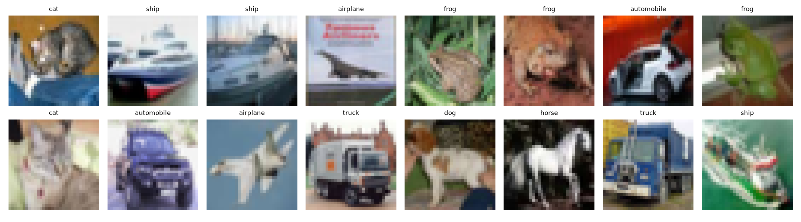
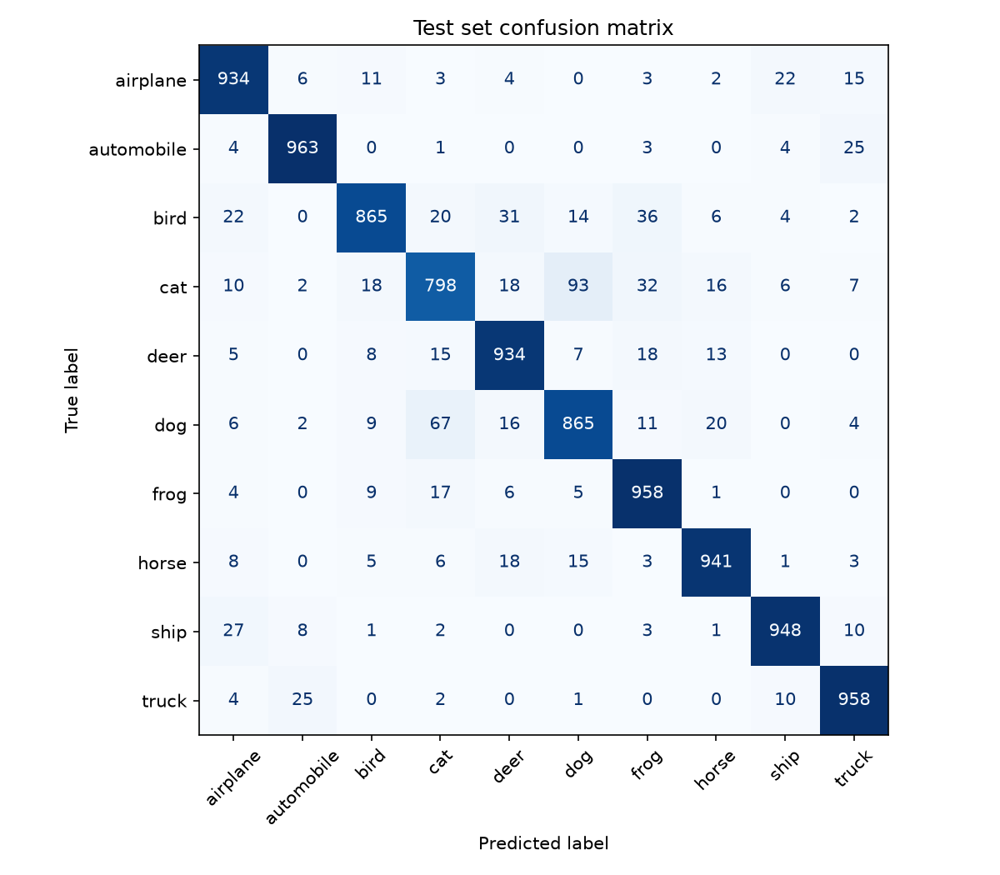
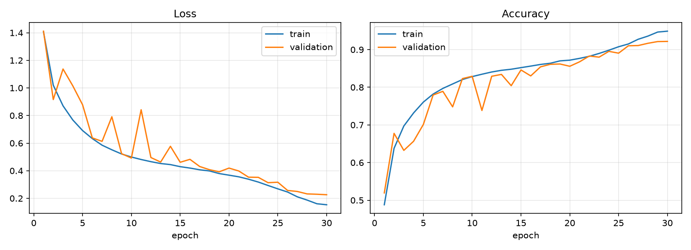

# CIFAR-10 CNN

[](https://github.com/Gauhet/cnn-image-classifier/actions/workflows/tests.yml)

A convolutional neural network written from scratch in PyTorch and trained on
[CIFAR-10](https://www.cs.toronto.edu/~kriz/cifar.html). It reaches **91.6% test accuracy**
with 1.1M parameters and trains in about 7 minutes on a laptop GPU (RTX 4050).



## Results

| | |
|-|-|
| Test accuracy | **91.6%** (10,000 held-out images) |
| Best validation accuracy | 92.2% (epoch 30) |
| Parameters | 1,148,874 |
| Training time | ~7 min, 30 epochs, RTX 4050 Laptop GPU |

Per-class test accuracy ranges from 96.3% (automobile) down to 79.8% (cat). Most mistakes
are between cats and dogs: 93 cats were labelled as dogs and 67 dogs as cats. At 32×32 pixels
the two are hard to tell apart even for people.





Validation accuracy jumps around in the middle of training while the learning rate is at its
peak, then settles as the one-cycle schedule anneals it. The gap between train and validation
loss stays small, so the augmentation and dropout are doing their job.

## How it works

**Model** ([`model.py`](src/cnn_classifier/model.py)). Three convolutional blocks with 64, 128
and 256 channels. Each block is two 3×3 convolutions with batch norm and ReLU, followed by max
pooling and dropout, taking the image from 32×32 down to 4×4. Global average pooling then
reduces each of the 256 feature maps to a single number, and one linear layer maps those to the
10 classes. Using average pooling instead of flattening the 4×4×256 output keeps the
classifier at 2,570 parameters instead of 40,970, and makes it less sensitive to where in the
image an object appears.

**Data** ([`data.py`](src/cnn_classifier/data.py)). 45,000 training images, with 5,000 held out
for validation using a fixed seed. Training images are randomly cropped (with 4 px reflection
padding) and flipped horizontally. All images are normalised with the per-channel mean and
standard deviation of the training set.

**Training** ([`train.py`](src/cnn_classifier/train.py), [`engine.py`](src/cnn_classifier/engine.py)).
SGD with Nesterov momentum (0.9) and weight decay (5e-4), and a one-cycle learning-rate schedule
peaking at 0.1. Mixed-precision training on the GPU. The checkpoint with the best validation
accuracy is kept, and the test set is used once, at the end.

## Running it

Requires Python 3.10+. Install PyTorch for your hardware first
([pytorch.org](https://pytorch.org/get-started/locally/)), then the package:

```bash
git clone https://github.com/Gauhet/cnn-image-classifier.git
cd cnn-image-classifier
pip install -e ".[dev]"
```

Train (CIFAR-10 downloads automatically on the first run, about 145 MB):

```bash
python -m cnn_classifier.train --epochs 30
```

Evaluate on the test set and regenerate the figures in `assets/`:

```bash
python -m cnn_classifier.evaluate
```

Classify your own images:

```bash
python -m cnn_classifier.predict my_cat.jpg
```

It prints the top three classes with their probabilities. Images are resized to 32×32, so
photos where the object fills most of the frame work best.

Run the tests:

```bash
pytest
```

Every script takes `--help` for its options (epochs, learning rate, batch size and so on).

## Project layout

```
src/cnn_classifier/
  data.py       dataset download, augmentation, train/val split
  model.py      the network, plus checkpoint save/load
  engine.py     training and evaluation loops
  train.py      training command
  evaluate.py   test-set metrics and figures
  predict.py    predictions on your own images
tests/          model, data and training-loop checks
results/        training history, metrics and log from the run above
assets/         figures used in this README
```

## What I'd try next

- Data loading is the bottleneck (GPU utilisation sits around 35%), so moving the augmentation
  onto the GPU would cut training time.
- Stronger augmentation such as Cutout or MixUp, plus label smoothing, typically adds 1–2 points
  on CIFAR-10.
- A residual network (ResNet-18) should reach about 95%, at the cost of roughly 10× more
  parameters.

## Background

I first worked on CNN image classification in WorldQuant University's *Deep Learning for Computer
Vision* lab. This repository is my own reimplementation on a public benchmark, written from
scratch; it contains no course material.

## License

[MIT](LICENSE)
